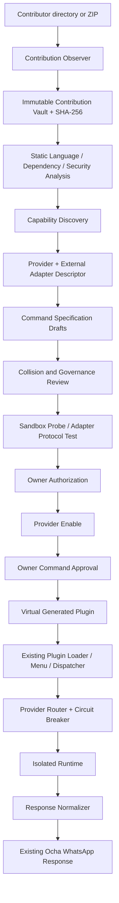

# ACIE Architecture

## Placement in Ocha

ACIE initializes after the existing JSONL database and before the WhatsApp socket begins. Its `.acie` command is a normal owner plugin, so it inherits the current prefix parser, dispatcher, private-chat gate and verified-owner authorization. It extends the existing `src/core/plugin-loader.js` registry through virtual plugin descriptors; it does not replace the loader, `src/core/dispatcher.js`, `src/core/plugin-execution.js`, `src/core/repository.js` or the JSONL database.

## Runtime boundaries

- Original contributed files are stored below `contributions/vault/<contributor>/<name>/versions/<version>/original/`.
- Manifest, provenance and analysis metadata sit beside, never inside, the original directory.
- `contributions/registry/` stores provider, capability and command specification metadata only.
- `adapters/` stores external adapter descriptors/bridge artifacts; the built-in JSON-stdio protocol implementation lives in `src/acie/adapters/`.
- `generated-commands/index.json` is the canonical command lifecycle registry. `contributions/registry/commands.json` is a compatibility mirror.
- `runtime-workspaces/` is reserved for private temporary workspace metadata. Part 2 uses ephemeral containers and read-only source mounts.
- `contributions/audit/` stores redacted JSONL operational history.

## Initialization and intake flow

`src/index.js` calls `initializeACIE()` after database initialization. The call provisions private storage and records execution-deny defaults. The VPS CLI invokes `runContributionIntake()`: original preservation, static analysis, capability discovery, adapter descriptor creation, provider registration and command drafting. No contributed file is passed to `import()` or `eval()`.

## Generated command integration

`src/acie/command-engine/runtime-commands.js` creates virtual Ocha plugin descriptors from eligible active command records. `src/core/plugin-loader.js` loads them alongside normal plugin files and refreshes them after provider/command lifecycle changes. The existing dispatcher, permission, cooldown, group policy, `.menu` and command catalog remain the only runtime path. Generated owner commands are private-only. No source file from the contribution is imported into the bot process.

An active command requires a matching active provider and all governance/integrity/security/runtime/protocol gates. Provider status is not enough by itself. Drafts and blocked collisions remain invisible.

## Provider runtime

Part 2 supplies the Docker/Podman runner with digest-pinned images, `--network=none`, read-only source/root, no inherited bot credentials and bounded resources. Part 3 adds persisted provider health, circuit state, approved command routing and response normalization. Public network egress is intentionally unavailable; remote-service integrations require a future reviewed allowlisted proxy. See `ACIE_PART3_COMMAND_INTEGRATION.md` for the operational sequence and boundaries.
