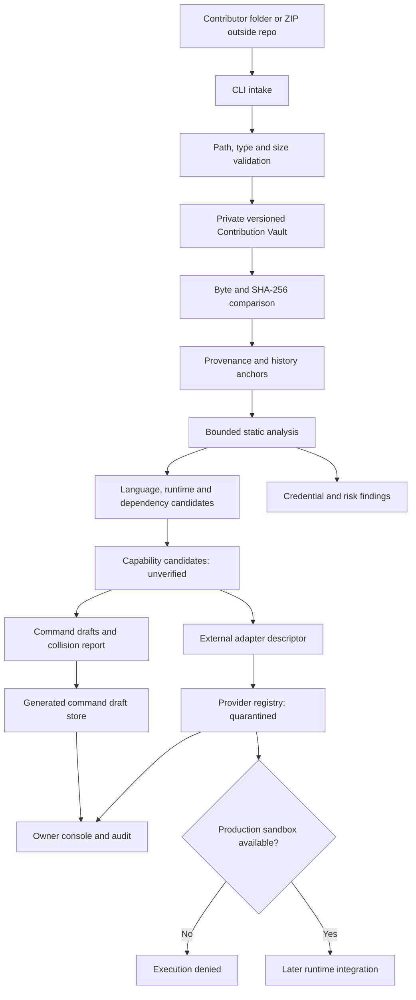

# ACIE Part 1 — Repository Audit and Contribution Preservation

**Release:** Ocha Lidya v1.10.43  
**Scope:** Repository audit, preservation vault, provenance, static discovery, governance defaults and owner operations.  
**Execution policy:** deny by default. No contributed source is executed in Part 1.

## 1. Repository integration audit

ACIE is integrated as an Ocha subsystem, not a replacement command framework or plugin loader.

| Existing Ocha component | ACIE integration |
|---|---|
| `src/index.js` | Calls `initializeACIE()` after the JSONL database is initialized and before WhatsApp socket startup; ACIE failure is caught so the normal bot can continue. |
| `src/core/plugin-loader.js` | Remains the authoritative active plugin loader. Contribution-derived command drafts are not loaded as plugins. |
| `src/core/dispatcher.js` | Remains the authoritative command parser/dispatcher. The `.acie` plugin follows this command path. |
| `src/core/identity.js` and owner policy | `.acie` is marked `ownerOnly` and `privateOnly`; it uses the existing verified-owner/private-chat controls. |
| Existing JSONL database | Not replaced. ACIE uses a separate private filesystem vault and JSON metadata registries. |
| Existing menu/help registry | Not duplicated. Draft commands are not advertised in the active menu until the later command-engine phase. |

## 2. Part 1 module layout

```text
src/acie/
├── core/             # private vault, paths, safe filesystem and SHA-256
├── intelligence/     # language, interface, capability and bounded static analysis
├── workers/          # scoped in-process worker roles and redacted failure summaries
├── orchestration/    # contribution intake pipeline
├── adapters/         # external adapter descriptors and response normalizer
├── routing/          # provider selection, error classification and circuit state
├── runtime/          # host inspection and hard fail-closed execution guard
├── registry/         # provider, capability and command-draft metadata
├── command-engine/   # command specification drafts and collision detection
├── response-engine/  # output normalization utilities
├── security/         # provider activation policy
├── governance/       # separate rights, identity and owner-review state evaluator
├── monitoring/       # contribution/provider/execution overview
└── telemetry/        # redacted trace/audit records
```

The worker roles currently execute sequentially inside the bot process as part of intake. They are not independent OS workers or a persistent distributed queue in this part.

## 3. Part 1 architecture



## 4. Original Contribution Vault

Default paths:

```text
contributions/
├── vault/<contributor>/<contribution>/
│   ├── current.json
│   ├── history.json
│   └── versions/vN/
│       ├── original/
│       ├── source-archive.zip       # only when input was ZIP
│       ├── manifest.json
│       ├── provenance.json
│       └── analysis.json
├── registry/
│   ├── providers.json
│   ├── capabilities.json
│   └── commands.json
├── metadata/
├── dependency-locks/
├── execution-profiles/
├── compatibility/
├── quarantine/
└── audit/events.jsonl

adapters/                            # external descriptors only
 generated-commands/                 # drafts, never active plugins in Part 1
 runtime-workspaces/                 # reserved; no contributed source runs here
```

`contributions/`, `adapters/`, `generated-commands/`, `runtime-workspaces/` and `config/acie.runtime.json` are Git-ignored. A non-secret starter configuration is provided at `config/acie.runtime.example.json`; copy it to `config/acie.runtime.json` only when you need to override defaults. Original versions are never overwritten; a subsequent submission creates `vN+1`.

Intake validates source type, ZIP entry paths, traversal, symlinks, special entries, duplicate ZIP paths and configured size/file-count limits. It copies original bytes, compares the resulting file inventory to the submitted directory, records empty directories, and makes original files/directories read-only on a best-effort basis.

For ZIP input, the raw archive is retained byte-for-byte and its SHA-256 is verified separately from the extracted file inventory. Version history anchors the final manifest, provenance and analysis hashes after the intake pipeline completes. `.acie contribution verify` checks files, directory inventory, preserved archive and those metadata anchors.

## 5. Static analysis and capability discovery

Supported language families: JavaScript/Node.js (including CommonJS and ES Modules), TypeScript, Python, Go, PHP, Java, Rust and Bash. Runtime/module classifications remain candidates until validation in a real isolated environment.

Default analysis limits:

| Limit | Default |
|---|---:|
| Candidate files | 5,000 |
| Text scanned | 64 MiB |
| One text file | 2 MiB |
| Retained static-analysis snippets | 8 MiB |

A partial scan reports `analysisCoverage.complete=false` and includes skipped-file counts/reasons. Capability identifiers are evidence candidates only and remain `unverified`; static regex matches do not prove reachability or runtime behavior.

Credential scanning includes common token patterns and credential assignments in source/config text such as `.env`, PEM/key files and manifests. Findings contain an identifier, file and line number only; matched values are not stored in analysis output, worker error summaries or audit records. This is heuristic scanning, not a full secret scanner.

## 6. Owner commands and intake

The `.acie` plugin is private-chat and verified-owner only. Rights metadata is evaluated by `src/acie/governance/governance-manager.js`; a submitted license string or attribution statement is recorded as pending human review and never proves authorization by itself.

| Command | Function |
|---|---|
| `.acie help` | Shows ACIE command help. |
| `.acie status` / `.acie overview` | Shows contribution, provider, command-draft, execution and worker summary. |
| `.acie contribution list` | Lists current contributions. |
| `.acie contribution inspect <id>` | Shows manifest, detected languages, runtime, dependencies and finding counts. |
| `.acie contribution verify <id>` | Verifies original file and metadata integrity. |
| `.acie contribution history <id>` | Lists immutable versions. |
| `.acie contribution provenance <id>` | Shows attribution and rights status. |
| `.acie capabilities` / `.acie languages` | Lists discovered capability candidates and languages. |
| `.acie provider list\|inspect\|status\|health\|enable\|disable` | Inspects and administratively disables providers; enable remains blocked without sandbox readiness. |
| `.acie routing status\|inspect\|simulate` | Inspects routing state and eligible providers; no provider is eligible in this Part 1 runtime. |
| `.acie commands` / `.acie commands conflicts` | Lists command drafts and name/alias collisions. |
| `.acie workers` | Shows worker-role state. |
| `.acie integrity\|security\|dependencies\|compatibility` | Reports stored review information. |
| `.acie audit [limit]` | Reads recent redacted audit events. |

Receive a contribution from the VPS, with the input folder/ZIP outside the repository:

```bash
npm run acie:intake -- \
  --source /srv/incoming/contribution.zip \
  --contributor-id contributor-001 \
  --contributor-name "Contributor Name" \
  --name pinterest-downloader \
  --project-id ocha-lidya-bot \
  --license "MIT" \
  --attribution "Original implementation provided by Contributor Name"
```

`--license`, `--attribution`, `--contributor-name` and `--contributor-contact` are optional. Missing rights/identity details are marked pending; no license or permission is inferred. The CLI prints metadata summaries only, not original source or credential values.

## 7. Current status against the master directive

| Capability | Part 1 status |
|---|---|
| Byte-preserved original source and version history | Implemented; SHA-256 verified, read-only is best effort. |
| Attribution, provenance, license and permission metadata | Implemented; missing information is pending human review. |
| JavaScript/CJS/ESM, TypeScript, Python, Go, PHP, Java, Rust, Bash discovery | Static candidate discovery implemented. |
| Dependency, entry-point, function/export and environment-variable discovery | Heuristic static candidate discovery implemented. |
| Credential and security-pattern scan | Heuristic, bounded and value-redacted. |
| Adapter abstraction | Descriptor and normalizer only; no executable adapter bridge yet. |
| Provider registry and command drafts | Implemented; provider quarantined and generated commands remain drafts. |
| Command collision detection | Static scan of existing plugin declarations and aliases implemented. |
| Active generated command/menu/help registration | Not implemented; reserved for Part 3. |
| Production isolated runtimes and dependency isolation | Not implemented; reserved for Part 2. |
| Live provider execution, health checks and fallback | Not enabled; execution stays fail-closed until Part 2 supplies and proves the sandbox. |
| Continuous filesystem observer / independent worker processes | Not implemented; Part 1 has sequential in-process worker roles used by intake. |
| Cryptographic vault encryption at rest | Not implemented; operator must use an encrypted host volume and encrypted backups. |
| Signed contributor identities / independent license or malware review | Not implemented; human governance review remains required. |

## 8. Security boundary and operational notes

- Do not commit contribution artifacts or private runtime state to Git.
- The vault is not encrypted by ACIE in Part 1. Use an encrypted filesystem/volume and encrypted backups before storing contributions with live credentials.
- File mode `0400/0500` is best-effort protection, not protection from root or a privileged host administrator. SHA-256 verification detects changes relative to stored integrity records; local metadata is not a remote signature or WORM ledger.
- No contribution is imported, `eval`-ed, compiled or executed by intake/static analysis.
- Registry flags alone cannot activate a provider. The provider gate additionally requires the production sandbox runtime, which is unavailable in Part 1.
- Do not edit the `original/` directory to fix a contribution. Ask for a new contributor submission and preserve it as a new version.

## 9. Three-part delivery plan

- **Part 1 (this release):** audit, vault, preservation, provenance, bounded static analysis, capability candidates, owner intake console and fail-closed governance.
- **Part 2:** runtime isolation, dependency workspaces, real adapters, worker execution boundaries, provider health and sandbox-backed routing/fallback.
- **Part 3:** capability-to-command engineering, live registry/menu/help integration, response mappings, command governance, full observability and acceptance testing across all three parts.

## 10. Validation record

- `npm run check`: passed; 255 JavaScript files checked.
- `node --test test/acie-foundation.test.js`: 23 passed, 0 failed.
- `npm test`: 325 tests total; 323 passed, 0 failed, 2 skipped.
- The skipped tests are reported by their existing test declarations; no failure was suppressed to obtain this result.
- Source ZIP intake depends on the declared `yauzl` package. Run `npm install` on the VPS before using `npm run acie:intake`.
