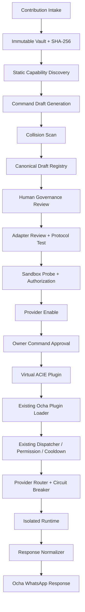

# ACIE Part 3 — Autonomous Command Engineering & Full Integration

**Release:** Ocha Lidya v1.10.45 · ACIE Part 3/3  
**Policy:** default-deny; owner-controlled activation; original contribution bytes remain immutable.

## Purpose

Part 3 completes the path from a discovered contribution capability to an Ocha command without creating a second command framework. Generated commands are virtual plugin descriptors managed by the existing `src/core/plugin-loader.js` registry. The existing dispatcher, permission enforcement, group policy, cooldown and menu/help discovery remain authoritative.

The contributed entrypoint is never imported into the bot process. A generated virtual plugin calls the ACIE provider router; the router calls the reviewed adapter through the Part 2 sandbox runner.

## Architecture



## Registry lifecycle

`generated-commands/index.json` is the canonical command draft and activation registry. `contributions/registry/commands.json` is maintained as a compatibility mirror. Writes use separate command and provider registry locks. A partial write is recoverable: command generation and the lifecycle manager reconcile the compatibility mirror from canonical entries on subsequent updates.

Command lifecycle values include:

- `draft-pending-validation`: generated from static capability evidence; not loadable.
- `draft-pending-review`: pending manual review.
- `blocked-collision`: an identifier could not safely be reserved.
- `active`: owner-approved and eligible for the virtual plugin loader, subject to provider gate.
- `rejected` / `revoked`: not loadable.

A name/alias collision is never silently overwritten. When the preferred name is occupied, ACIE tries an `acie-` namespace with a bounded numeric suffix. Conflicting aliases are dropped. If no safe name can be reserved, the draft is marked `blocked-collision` and requires manual intervention.

## Provider activation gates

`canActivateProvider()` requires all of the following:

1. License metadata reviewed.
2. Contributor attribution confirmed.
3. Original contribution integrity verified.
4. Adapter descriptor reviewed.
5. Adapter test passed.
6. Adapter JSON-stdio protocol test passed.
7. Sandbox profile approved.
8. Docker/Podman host probe available.
9. Explicit owner authorization.
10. Output contract verified.
11. No critical/high static security finding.

A previous successful protocol-test flag is cleared before a new test begins. A failed re-test therefore cannot leave a stale green status. Provider health and circuit-breaker outcomes are persisted in the provider registry.

## Owner review workflow

All commands below run in the verified owner's private WhatsApp chat:

```text
.acie status
.acie contribution list
.acie contribution inspect <contribution-id>
.acie contribution verify <contribution-id>
.acie provider list
.acie provider inspect <provider-id>
.acie provider review <provider-id> license
.acie provider review <provider-id> attribution
.acie adapter review <provider-id>
.acie runtime status
.acie runtime probe
.acie provider review <provider-id> sandbox
.acie provider review <provider-id> authorization
.acie adapter test <provider-id> [capability-id]
.acie provider enable <provider-id>
.acie commands list
.acie commands inspect <command-id>
.acie commands test <command-id>
.acie commands approve <command-id> public|owner
.acie commands sync
```

The order is intentional. An adapter protocol test is permitted only while the provider remains quarantined, and requires the provider to have completed license, attribution, adapter, sandbox and owner authorization review. Provider enable requires a successful protocol test and the host runtime probe. Command approval only succeeds after the provider is active and eligible.

To retire an integration:

```text
.acie commands revoke <command-id>
.acie provider disable <provider-id>
```

Revocation removes only the virtual plugin registration. It does not delete or modify the original contribution.

## Menu, help and dispatcher integration

The plugin loader calls `loadGeneratedCommandPlugins()` during initial load and hot reload, and exposes an explicit refresh for owner lifecycle operations. Generated commands are virtual plugin objects, not files written into `src/plugins/`. Only records with `status=active`, `registeredInPluginLoader=true`, `visibleInUserMenu=true`, approved permission (`public` or `owner`), an active matching provider, and a passing provider gate are loaded.

The existing `.menu`, command catalog and dispatcher discover the virtual plugins through `listPlugins()`. There is no second menu or dispatcher. Owner-only generated commands are also private-chat-only. Public commands still pass through the existing Ocha group policy, cooldown, rate and quota layers.

## Provider routing and fallback

Provider selection checks capability, provider status, governance/security gate, quota, availability, rate-limit window and circuit-breaker state. Priority is ascending numeric order. Health counts, response duration, last error class and circuit state are persisted with the provider registry.

Fallback is allowed only when the operation is explicitly idempotent and the classifier marks the failure retryable. Authentication, invalid input, quota exhaustion, invalid output and other permanent failures do not trigger automatic replay. The generic generated command wrapper marks only metadata/search operations idempotent; downloads and other side-effecting capabilities are not automatically replayed.

## Response normalization

Only documented response fields are passed to the Ocha renderer. URLs and media references must use HTTPS; credentials in URL query parameters and credential-like metadata keys are removed. Text redaction covers common API-key, bearer, password and secret assignment patterns. Attribution is appended when provided.

This release currently returns HTTPS media links as message text. It does not automatically fetch local files or send arbitrary media payloads through WhatsApp. A dedicated reviewed media-delivery adapter is required for that behavior.

## Adapter contract

The built-in generic bridge supports CLI-style JSON-stdio entrypoints using `acie-json-stdio-v1`: one JSON object on stdin and one JSON object on stdout. Stdout must contain machine-readable JSON only. Export-only library modules require a separately reviewed wrapper stored outside the original vault. The adapter must not mutate the original source.

## Security boundary and known limitations

- The Part 2 sandbox runs with `--network=none`. Internet-dependent downloaders cannot access public services through this runner. Do not relax this boundary for convenience; an allowlisted egress proxy and per-provider policy must be designed and reviewed separately.
- Dependency installation into immutable source is not supported. Runtime images must contain the required interpreter/runtime/dependencies, or a future isolated dependency-cache service must provide them.
- TypeScript and Rust are statically discoverable but not executable with the generic runtime command map.
- No independent malware scanner, legal license review service or cryptographically signed contributor identity is included.
- Vault encryption-at-rest is host-managed; use an encrypted volume and encrypted backups.
- Live container execution and WhatsApp menu delivery must be verified on the target VPS. Unit tests do not prove the remote host has Docker/Podman or the required digest-pinned images.

## Test coverage

Part 3 tests cover capability-to-command mapping, collision namespacing, dual registry synchronization, owner approval gates, virtual plugin loading policy, safe response rendering, provider health persistence, protocol-test activation requirements and staged sandbox review. Full suite results are recorded in `CHANGE_LOG.md` for the release build.
