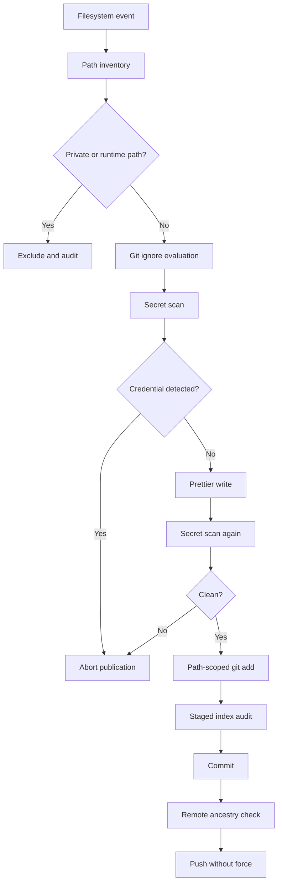

# Automatic Git Monitoring and Push

## Scope

`src/core/auto-git-sync.js` watches the project root while the application is running. It observes file additions, changes, and removals across source, documentation, package metadata, tests, and scripts. The watcher excludes `.git/`, all `node_modules/`, `sessions/` and quarantined session backups, `data/`, `logs/`, and cache/build/temp/artifact directories at filesystem-watcher level, before Chokidar descends into those trees. `.env` is observed only to refresh the Git token and is never staged; `.env.*` secrets are excluded. Other exclusions are evaluated against the active Git ignore rules.

## Ignore policy

Before staging, the service reads `.gitignore` and records the active pattern count. It then calls `git check-ignore --no-index` for every changed path. This delegates pattern evaluation to Git, including directory patterns, nested matching, escaped patterns, and negation rules. Files rejected by the ignore policy are not passed to `git add`. A second check inspects already staged paths and aborts the commit if any staged path is ignored or belongs to a hard-excluded directory.

The service stages only changed eligible paths individually using `git add -A -- <path>`. It does not use a blind `git add .` or `git add -A` over the entire working tree. This captures modifications, creations, and deletions, including rename source/destination paths.

## Commit clock

The automatic commit subject is:

`pasang waktu Otomatis, waktu, tanggal, jam, dan hari yang kompleks.`

The commit body includes a localized Indonesian weekday, date, and time in `Asia/Jakarta` (`WIB`) plus an ISO-8601 timestamp. The commit timestamp is generated when the commit is created, not when the watcher starts.

## GitHub authentication

The only token variable consumed by the sync service is `GITHUB_PAT`. It belongs in the untracked `.env` file and must not be copied into configuration JSONL, source, the Git remote URL, or logs. The temporary askpass helper is stored under the operating system temporary directory and removed after network operations.

Recommended token settings: fine-grained PAT scoped only to `razzaqinspires/ocha-lidya-whatsapp-bot`, with repository Contents read/write permission. GitHub documents PATs as the password for HTTPS Git operations and recommends fine-grained PATs when possible. The remote must be the HTTPS URL `https://github.com/razzaqinspires/ocha-lidya-whatsapp-bot.git` under the name `origin`. The branch must be `main`.

## Ordering and conflict handling

1. Read `.gitignore` and inspect Git status.
2. Exclude ignored paths and stage only eligible changes.
3. Verify staged paths against ignore rules again.
4. Create a timestamped commit if there are staged changes.
5. Fetch `origin/main` using the PAT-backed askpass helper.
6. Rebase only when remote history is a direct ancestor of local `HEAD`.
7. Push to `origin/main` without force.

If branches have diverged, a rebase conflicts, credentials are invalid, remote is wrong, the branch is not `main`, or Git identity is missing, the sync service logs a failure and leaves local work intact. It never force-pushes or deletes local changes. Resolve the reported issue and trigger another filesystem change or restart the bot to retry.

## Setup

```bash
cp .env.example .env
# Edit .env and provide GITHUB_PAT.
npm install
npm run git:setup
git config user.name "Your Git Author Name"
git config user.email "your-verified-email@example.com"
npm start
```

When the project is already cloned from the target repository, `git:setup` verifies rather than replacing a matching origin. If a local directory is initialized independently while GitHub already has a history, prefer cloning the remote first and placing the project files into that clone. The service will not force-push or overwrite unrelated remote history.

## Runtime requirement

Automatic monitoring runs only while the Node.js process is alive. The bot starts it automatically only after validating that the project root is a Git repository on the expected branch with the expected `origin` remote. ZIP extractions without `.git/` now disable Auto Git Sync with one warning instead of repeatedly logging `fatal: not a git repository`. Initialize/clone the repository with `npm run git:setup` or clone the intended GitHub repository, then restart the bot. `npm run git:watch` is available to run the watcher without the WhatsApp bot for troubleshooting. The watcher is not an OS-level daemon and does not run when the device is off or the application process is stopped.

## Linux inotify capacity

Do not raise `fs.inotify.max_user_watches` as the first fix for `ENOSPC`. The primary fix is to avoid watching Baileys auth state: `sessions/` contains one file per Signal pre-key/session and can grow over time. The watcher policy excludes it before traversal. If `ENOSPC` still occurs after upgrading, inspect other processes' watcher usage and only then consider raising the host's inotify limit. On watcher exhaustion, Ocha logs one compact error and closes the failed watcher instead of producing an error storm.

## v1.10.50 publication firewall

The public repository is retained, but the following locally maintained source modules are explicitly excluded from future publication: `src/lib/helpers.js`, `src/lib/freply.js`, `src/lib/serializ_simple.js`, and `src/plugins/owner/message-lab.js`. They are also excluded from recursive watching. The publication policy additionally blocks private instruction files, private-key files, credentials/secrets directories, and local release staging.

Before staging, Auto Git Sync audits changed paths, scans eligible text files for common GitHub/OpenAI/Google/AWS/private-key and generic credential patterns, formats eligible public files with Prettier, scans again, stages eligible paths only, then audits the complete Git index. Secret values are never included in logs. If Prettier is not installed or a secret pattern is found, publication stops; no automatic source rewriting/redaction is attempted because changing a credential-bearing source file without knowing its intended configuration contract can break runtime behavior.

Run `npm run security:publication` for a local inventory and secret scan. Install Prettier with `npm install` after updating package metadata. `OCHA_PRETTIER_BIN` may override the `npx` executable path.

### Important existing-history limitation

These four files were already tracked in prior public versions. `.gitignore` and the publication firewall prevent future additions/updates from being published, but do not erase previous public GitHub commits, forks, caches, or clones. To make them private going forward, migrate their implementation into a local-only private runtime package and update imports/installation accordingly, then perform a reviewed history rewrite only if the repository owner explicitly approves it. A public Git repository cannot keep a tracked plaintext module private. This release does not pretend otherwise and does not break imports by deleting the runtime files.

### Private rules and credentials

Project instructions, `ADDITIONAL_INSTRUCTIONS.*`, local private-core key files, `.env`, credentials, and private staging directories are excluded. Do not place private operating rules in README, public docs, package metadata, or public test fixtures. `.env.example` may contain placeholders only.

## Publication pipeline map



## Source/function map

| Component             | Source                           | Responsibility                                                          | Tests                                                                         |
| --------------------- | -------------------------------- | ----------------------------------------------------------------------- | ----------------------------------------------------------------------------- |
| Publication policy    | `src/core/publication-policy.js` | Private path rules, secret pattern scan, eligible-path classification   | `test/publication-policy.test.js`                                             |
| Auto Git Sync         | `src/core/auto-git-sync.js`      | Watch, format, scan, stage, commit, reconcile and push                  | Existing runtime integration; manual audit via `scripts/publication-audit.js` |
| Watch policy          | `src/core/watch-policy.js`       | Prevent watcher traversal into private/runtime paths                    | `test/watch-policy.test.js`                                                   |
| Publication audit CLI | `scripts/publication-audit.js`   | Inventory local files and scan publishable text for credential patterns | Run `npm run security:publication`                                            |

## v1.10.57 dual-repository extension

Ocha's normal startup now uses `src/core/auto-push-runtime.js` to start two independent publication lanes: the existing Ocha root watcher (`GITHUB_PAT`) and a second watcher rooted exclusively at `.private/artificial-consciousness-component` (`AC_GITHUB_PAT`). The root Ocha watcher retains its original path-scoped staging and publication firewall, and `.private/` remains ignored before traversal. The AC lane has its own exact allowlisted `origin`, `main` branch, path policy, token and Git index. It cannot add files to the parent Ocha index. See [`AUTO_PUSH_TWO_REPOSITORIES.md`](AUTO_PUSH_TWO_REPOSITORIES.md) for setup, credentials, hidden owner controls, exclusions and troubleshooting.

The prior `npm run git:setup` and `npm run git:watch` scripts are retained for compatibility. The standard `npm start` lifecycle launches both lanes when both Git roots are ready. The old `git:watch` remains Ocha-only.
