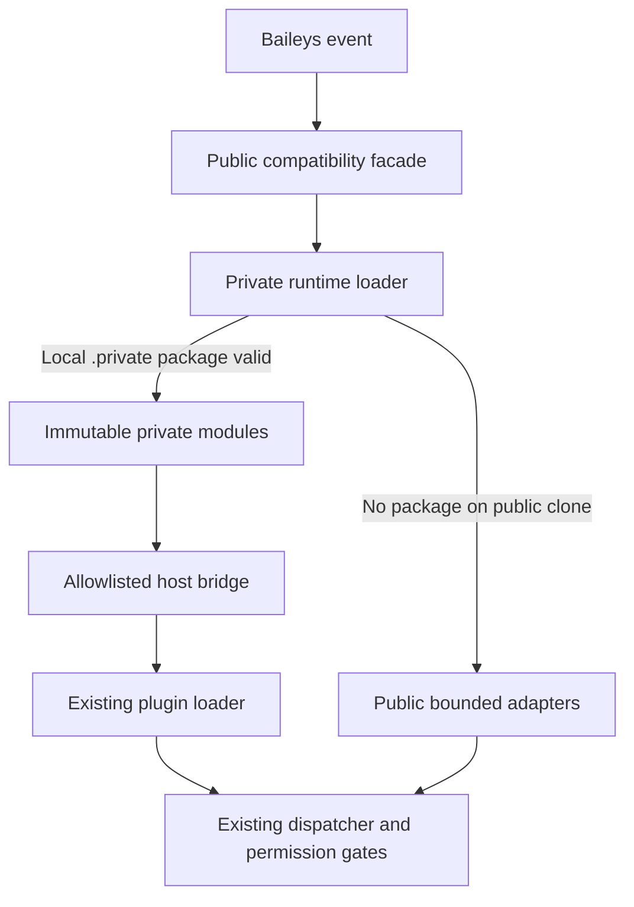

# Private Runtime Extraction and Public Compatibility — Ocha Lidya v1.10.52

## Decision

The four owner-designated implementation modules are co-located with the complete Ocha operator base under `.private/ocha-private-runtime/`. This is an ignored, local-only directory. The public source tree contains stable compatibility facades and does not contain the implementation bytes. A clean public Git clone therefore starts in `public-compatibility` mode.

This is intentionally one Ocha operator base with local private core files held by `.gitignore`, publication policy, Auto Git Sync, source fingerprint checks, the source watcher and Prettier ignore/target rules. The complete operator ZIP contains the private source for installation on the owner's VPS and must never be published to GitHub.

| Original source path               | Public facade                               | Local private original/runtime source                                                                                   | SHA-256                                                            |
| ---------------------------------- | ------------------------------------------- | ----------------------------------------------------------------------------------------------------------------------- | ------------------------------------------------------------------ |
| `src/lib/helpers.js`               | same public path, bounded compatibility API | `.private/ocha-private-runtime/original-source/src/lib/helpers.js` and `src/lib/helpers.js`                             | `f653ff54a4936fb3615b0df29a6001ed651270d737c15300aebb860888224c40` |
| `src/lib/freply.js`                | same public path, bounded compatibility API | `.private/ocha-private-runtime/original-source/src/lib/freply.js` and `src/lib/freply.js`                               | `6874b5655c3f194dc7ceea1d6512ae2b5a32bf14af5481ce63647f8ffbe733a2` |
| `src/lib/serializ_simple.js`       | same public path, serializer facade         | `.private/ocha-private-runtime/original-source/src/lib/serializ_simple.js` and `src/lib/serializ_simple.js`             | `dea18b22b6cfe635e222750b4742f4c43f1e483e36a018045d4142f1ede98ef8` |
| `src/plugins/owner/message-lab.js` | no public plugin file                       | `.private/ocha-private-runtime/original-source/src/plugins/owner/message-lab.js` and `src/plugins/owner/message-lab.js` | `c47883b8cf6d6c3de18085d4e43a82c543768edd0df6782f52a97770fdd068c6` |

The package manifest also records the source ZIP SHA-256, version, provenance and byte sizes. `scripts/install-private-runtime.js` verifies package identity, exact file set, path boundaries, byte sizes and hashes.

## Architecture and modes



Private runtime startup resolves in this order: explicit `OCHA_PRIVATE_RUNTIME_PATH`, bundled `.private/ocha-private-runtime`, then installed `node_modules` package. A clean public clone omits `.private` through Git and continues in text-first compatibility mode. Set `OCHA_PRIVATE_RUNTIME_REQUIRED=1` only on the private operator VPS to fail closed if its local package is missing or fails verification.

The private `.test` plugin is inserted into the existing plugin registry only if its descriptor remains `ownerOnly: true` and `privateOnly: true` and canonical name/aliases pass collision checks. It is never added to the public compatibility mode.

The private host bridge allowlists `src/lib/contact-card.js`, `src/core/reply-sessions.js`, `src/lib/message-text.js`, `src/lib/native-flow-registry.js`, `src/core/logger.js`, and `src/plugins/owner/message-test-catalog.js`. No second dispatcher or serializer framework is introduced.

## Local operator commands

```bash
# Verify the bundled local private package, without installing or executing contributed code
npm run private-runtime:verify

# Recheck and report the loaded runtime mode
npm run private-runtime:status

# Required private mode on an owner-controlled VPS
OCHA_PRIVATE_RUNTIME_REQUIRED=1 npm start

# Publication audit before Git staging
npm run security:publication
```

The complete operator bundle includes `.private/ocha-private-runtime/`. A public Git checkout does not. Never copy the four original modules back into `src/`; the facade path must remain the only public source.

## Formatter and source immutability

`npm run format` and `npm run format:check` target public adapters, normal source, tests, scripts and documentation. `.prettierignore` excludes `.private/`, and the private package's own Prettier target list excludes its four immutable runtime and receipt copies. The private source verifier runs before runtime import and can be run independently.

Auto Git Sync classifies `.private/` and ACIE runtime registries as protected, scans staged public text for credential patterns, checks private source SHA-256 fingerprints before and after formatting, and stages paths individually. It does not use `git add .`. The publication audit also works on ZIPs without Git metadata; the filesystem fallback omits private/runtime state trees and scans eligible public paths only.

## Historical Git limitation

The four original modules existed in earlier public Git history. `.gitignore` prevents future untracked copies from being staged; it does not erase previously committed Git objects or rewrite remote history. The current package is designed to keep future releases clean. Full historical removal requires an explicit owner-approved history rewrite, coordinated clone refresh, and credential/source exposure review. This migration does not force-push or alter GitHub history.

## Validation boundaries

The package integrity test verifies all four source/runtime copies and original receipts. Public adapter tests verify JID/PN handling, text reply and button downgrade behavior without private source. Private-mode tests verify exact package identity, source hashes and owner/private plugin contract. Full test counts and WhatsApp/VPS results belong in the release report; do not claim live WhatsApp rendering from mock serializer tests.
