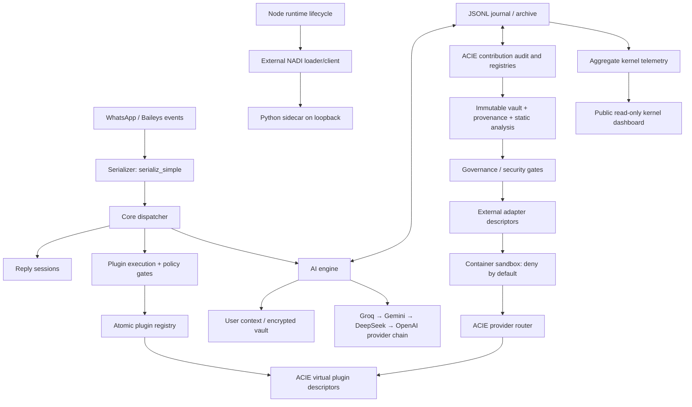

# Repository Audit — Ocha Lidya v1.10.51

**Audit date:** 2026-11-26  
**Input:** user-supplied `ocha-lidya-bot.zip`  
**Archive SHA-256:** `a117c61d3ea944259ae00fa492f42d61dda935fa54457837a2fe32087f97a476`  
**Package version inside archive:** `1.10.51`  
**Git metadata in archive:** absent  
**Audit mode:** read-only source inspection; documentation update in working copy only; no contributed code executed.

## Executive finding

The supplied archive contains an advanced Ocha source snapshot with ACIE, a multi-provider AI engine, private JSONL persistence, serializer integration, and an external NADI runtime client. The source package is internally consistent enough to pass JavaScript syntax checking and focused regression tests, but it is **not a verifiable Git checkout** and is not ready to publish as an archive: it contains a local `.env` and runtime JSONL/config artifacts, plus owner-designated private modules.

The live public repository is `razzaqinspires/ocha-lidya-whatsapp-bot`, branch `main`, latest inspected commit `9e5791778f35838531d937df20a11dee53d25ef2` (2026-11-26 14:04 WIB). That public branch reports package version `1.10.48`. The supplied archive reports `1.10.51`. Since the archive has no `.git` directory, there is no evidence that it descends from that live commit or a particular local branch. Treat the ZIP as a candidate local development snapshot, not as a verified latest Git revision. Do not overwrite or force-push either side without a real checkout and diff-based reconciliation.

## Bootstrap/documentation check

| Required item     | Observed path/status                                            | Result                                                                                 |
| ----------------- | --------------------------------------------------------------- | -------------------------------------------------------------------------------------- |
| AI context        | `.private/project/AI_CONTEXT.md`                                | Present, stale baseline `1.10.50`; updated in this documentation pass                  |
| AI workflow       | `AI_WORKFLOW.md`                                                | Missing; added as private `.private/project/AI_WORKFLOW.md`                            |
| README            | `README.md`                                                     | Present; added audit/source/registry navigation                                        |
| Changelog         | `docs/CHANGE_LOG.md`                                            | Present; no root `CHANGELOG.md`; updated and added root pointer                        |
| ACIE architecture | `docs/ACIE_ARCHITECTURE.md`, Parts 1–3                          | Present and source cross-checked                                                       |
| Command registry  | `docs/MENU_AND_COMMAND_REGISTRY.md`                             | Describes live menu source; not a full detailed inventory; added static audit registry |
| Provider registry | `src/ai/providers.js`, `src/acie/registry/provider-registry.js` | Two different provider systems; documented separately                                  |
| Serializer        | `src/lib/serializ_simple.js`                                    | Runtime import confirmed; owner-designated private source                              |
| Database          | `src/core/database.js`                                          | JSONL journal/archive implementation inspected; runtime records not read               |

## Actual architecture path

The bot keeps one production chat-generation provider chain. The ACIE contributed-provider registry is separate and must not be conflated with Nexora's AI provider list. NADI is a separate Python repository and does not create a second chat LLM chain.

## Verified implementation matrix

| Domain                | Source-of-truth files                                                            | Verified behavior                                                                                                                                          | Status                                                 |
| --------------------- | -------------------------------------------------------------------------------- | ---------------------------------------------------------------------------------------------------------------------------------------------------------- | ------------------------------------------------------ |
| Runtime boot/shutdown | `src/index.js`                                                                   | Initializes DB, ACIE, AI keys, NADI, plugins and socket in explicit sequence; shutdown drains workers and closes runtime                                   | `ANALYZED`                                             |
| Plugin registry       | `src/core/plugin-loader.js`                                                      | Imports trusted in-tree plugins, atomically refreshes registry, retains prior valid plugin on failed replacement, merges eligible ACIE virtual descriptors | `ANALYZED`                                             |
| Authorization         | `src/core/dispatcher.js`, `src/core/plugin-execution.js`, `src/core/identity.js` | Verified owner, chat scope, tenant access, cooldown, anti-spam and plugin gates run before execution                                                       | `ANALYZED`                                             |
| Serializer            | `src/lib/serializ_simple.js`, `src/lib/native-flow-registry.js`                  | Baileys message normalization and native-flow callbacks feed the existing dispatcher                                                                       | `ANALYZED`; private source                             |
| Persistence           | `src/core/database.js`, `src/ai/user-vault.js`                                   | JSONL journal and archive system; per-user private vault separate from global NADI operational telemetry                                                   | `ANALYZED`; live DB not inspected                      |
| AI providers          | `src/ai/providers.js`, `src/ai/engine.js`, `src/config.js`                       | Four provider IDs, multiple keys/provider, provider error classification, ordered fallback, bounded deadlines and masked telemetry                         | `ANALYZED`; live health unknown                        |
| ACIE                  | `src/acie/**`                                                                    | Immutable source intake, heuristic discovery, governance, quarantined providers, isolated runner, virtual command integration                              | `ANALYZED`; active registry/runtime not included       |
| NADI client           | `src/runtime/nadi-component.js`, `src/runtime/consciousness-runtime.js`          | Pinned external source load, archive guard, loopback client, health polling, restart backoff and graceful stop                                             | `ANALYZED`; external NADI package not locally executed |
| Telemetry/dashboard   | `src/runtime/kernel-telemetry.js`, `src/runtime/kernel-dashboard.js`             | Aggregate counts/latencies; public dashboard strips message content and identifiers                                                                        | `ANALYZED`; tunnel not probed                          |

## Command and alias audit

The static exported-descriptor inventory contains **47 canonical commands and 89 declared aliases (136 identifiers)** across `src/plugins/**/*.js`. No normalized canonical/alias collision was found in that source set. The plugin directory has 48 JavaScript files; `src/plugins/owner/message-test-catalog.js` is a helper catalogue, not a plugin command. Full details are in [`COMMAND_REGISTRY_AUDIT_1.10.51.md`](COMMAND_REGISTRY_AUDIT_1.10.51.md).

This is not a live runtime registry check. The ZIP does not contain dynamic ACIE provider/command registries and the plugin registry was not booted against WhatsApp. Execute `.commandaudit scan` on the real live process after the dynamic registry loads. `src/master/dispatcher.js` also recognizes separate owner-gated tokens `>>>`, `>>`, `=>`, `>`, `$`; these are not plugin commands.

## Provider audit

Nexora AI provider order defaults to `groq`, `gemini`, `deepseek`, `openai`. Provider key rotation, status classification and bounded fallback exist in source. No provider can be called healthy/active without reading runtime provider telemetry and performing a health check. The separate ACIE contributed-provider registry starts quarantined and enforces license, attribution, integrity, adapter, protocol, sandbox, runtime, output contract, security and owner approval gates. Details: [`PROVIDER_REGISTRY_AUDIT_1.10.51.md`](PROVIDER_REGISTRY_AUDIT_1.10.51.md).

## Contribution Mode — Rizkyrohan Text Canvas

- Contributor: Rizkyrohan.
- Source fixture: `acie-fixtures/contributions/rizkyrohan-text-canvas-v1/original/index.mjs`.
- Source bytes: 3,460; SHA-256: `30e451e96eedfa9c755b5f23f7825e19ea059749707cfd8b5878f72f7b4f4a43`.
- Detected capability: `image-canvas.render.text` (heuristic candidate, `unverified`).
- Draft command: `.textimage`, alias `.timg` (not active, not in public menu).
- License/asset rights: pending; `@napi-rs/canvas` not pinned in source; font/background files absent; bridge/protocol/sandbox tests and owner approval incomplete.
- Source was not imported, evaluated or modified. Existing contribution docs preserve the provenance and block activation.

## Security and publication blockers

1. The supplied ZIP contains a local `.env` file (2,524 bytes, mode 0644). Its content was not read or printed in this audit. The archive also contains JSONL/config runtime files under `data/`; their content was not inspected. These files should never be included in a public source package. If the archive has been shared outside a trusted workstation, rotate/revoke the credentials represented in the local `.env` and review the recipients.
2. The release manifest marks four source modules and private context/policy files as local-only. They remain necessary for the supplied runtime. A clean public clone may not boot until these modules are moved to a separate private runtime package. Do not rewrite public history without explicit owner approval.
3. `.git`, `package-lock.json` and `node_modules` are absent from the ZIP. Reproducible `npm ci`, branch ancestry checks, complete test-suite execution and safe auto-publication cannot be established from this archive.
4. The live public branch is `1.10.48`, while the supplied archive is `1.10.51`; reconcile with a real clone and a reviewed diff before creating commits.

## Tests and checks

| Check                             | Result                      | Scope                                                                                                                                    |
| --------------------------------- | --------------------------- | ---------------------------------------------------------------------------------------------------------------------------------------- |
| `npm run check`                   | PASS — 275 JavaScript files | Static JS syntax only                                                                                                                    |
| Focused ACIE/NADI/telemetry tests | PASS — 36 tests, 0 failures | `acie-runtime-isolation`, `acie-command-engine`, `acie-rizkyrohan-canvas`, `nadi-component`, `consciousness-runtime`, `kernel-telemetry` |
| Full `npm test`                   | NOT RUN                     | Runtime dependencies and lockfile absent                                                                                                 |
| Docker/Podman execution           | NOT RUN                     | No reviewed/pinned container runtime was probed                                                                                          |
| WhatsApp target-host test         | NOT RUN                     | No live socket/session used                                                                                                              |
| External NADI selftest            | NOT RUN                     | Pinned Python source inspected via GitHub; no local checkout/environment                                                                 |

## Prioritized next changes

1. **P0 — Sanitize release input:** exclude `.env`, runtime `data/*.jsonl`/config snapshots, sessions and all private modules from any shareable archive. Keep the user's local operating files safe; do not delete runtime data as an audit shortcut.
2. **P0 — Git reconciliation:** clone the live repository, inspect branch and `git diff`, compare version 1.10.51 against `main` 1.10.48, then create a review branch. No force-push.
3. **P1 — NADI MIMPI deduplication:** add a persisted consolidation-window digest and idempotency regression tests in the separate NADI repository.
4. **P1 — NADI long-gap stability:** run the `dt=1..300` numerical experiment and adopt exponential relaxation or bounded substeps if supported by observations.
5. **P1 — Runtime registry verification:** run `.commandaudit scan`, `.acie provider list`, `.acie commands list`, `.aistatus`, `.nadi status` on the controlled VPS and capture redacted results.
6. **P2 — Reproducible full tests:** restore a lockfile from the authoritative branch and install dependencies in an isolated clone, then run full `npm test`, check, lint and host integration tests.
7. **P2 — Private runtime split:** design a compatibility package for the four owner-designated private modules and document the clean-clone migration before removing local files.

## Change status

- Runtime source changes: **none**.
- Original contributed source: **PRESERVED** (not modified or executed).
- Static capability discovery: **ANALYZED**.
- ACIE generated provider/command: **QUARANTINED / NOT ACTIVE**.
- New documentation and workflow files: **created in this local working copy only**.
- Remote branch or commits: **unchanged**.

## Follow-up — private runtime extraction

The four owner-designated modules previously listed as a publication blocker have since been copied byte-identically into `@razzaqventures/ocha-private-runtime` v1.10.51, with source receipts and SHA-256 manifest. The public tree now has three compatibility facades and an optional loader; `src/plugins/owner/message-lab.js` is absent from the public plugin directory. The publication policy and Auto Git Sync now detect exact source fingerprints independent of path. Public-compatible mode and private-runtime mode are documented in [`PRIVATE_RUNTIME_EXTRACTION.md`](PRIVATE_RUNTIME_EXTRACTION.md).

This follow-up is a local migration workspace only. A real Git checkout is still required to reconcile local v1.10.51 against public `main` v1.10.48. The private package has not been installed into a live VPS, full `npm test` has not been run, and a Prettier binary was unavailable in the supplied container; do not infer production activation or a completed Prettier pass.

## Follow-up: Public / Private Runtime Extraction

The four owner-designated modules are now packaged in the external `@razzaqventures/ocha-private-runtime@1.10.51` package with byte-identical runtime copies and retained original-source receipts. Public facades support the no-package compatibility mode. Use `npm run private-runtime:verify -- /absolute/path/to/package` before the separately authorized `private-runtime:install` operation. Private mode remains inactive in this workspace.

Validation after extraction: 281 JavaScript files syntax-checked; 50 focused root tests passed; private integrity check and 3 package tests passed; 72 Markdown files passed local-link validation; filesystem publication audit passed. Prettier scripts/config are present but execution is blocked by missing binary and npm registry DNS failure (`EAI_AGAIN`). Full root tests, live WhatsApp, VPS install and GitHub publication were not performed.
