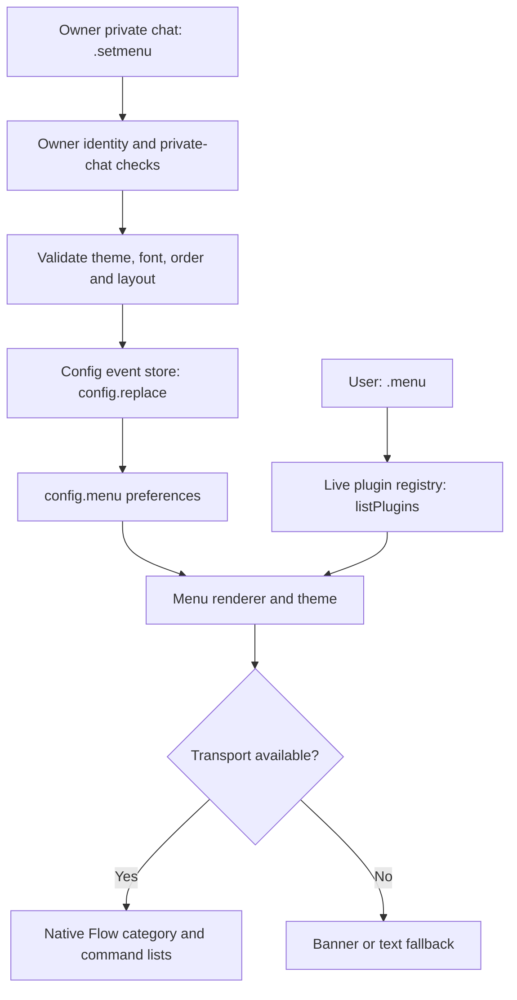
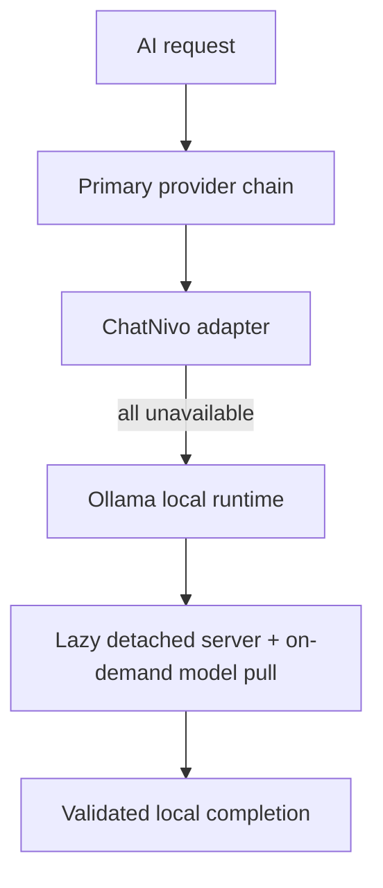

# Ocha Lidya Bot — Project Structure

This document describes the source layout of the Ocha base and the boundary between public source, local-only operator data, and the independent Artificial Consciousness Component. The repository root is intentionally minimal: `README.md` is its only Markdown document.

## Root policy

| Root entry         | Purpose                                                                          | Publication status |
| ------------------ | -------------------------------------------------------------------------------- | ------------------ |
| `README.md`        | Public project overview and documentation index                                  | Public             |
| `package.json`     | Node package metadata and scripts                                                | Public             |
| `.prettierrc.json` | Formatter configuration                                                          | Public             |
| `.prettierignore`  | Formatter exclusions                                                             | Public             |
| `.gitignore`       | Git publication exclusions                                                       | Public             |
| `.env.example`     | Safe configuration template without secrets                                      | Public             |
| `.private/`        | Private runtime source, contribution originals, and private project intelligence | Git-ignored        |
| `.release/`        | Generated operator bundle metadata and local release inventory                   | Git-ignored        |

No `CHANGELOG.md`, `PROJECT_STRUCTURE.md`, or `OPERATOR_BUNDLE.json` file is kept directly in the repository root.

## Repository map

```text
.
├── README.md
├── package.json
├── .prettierrc.json
├── .prettierignore
├── .gitignore
├── .env.example
├── .private/                         # Local-only source and project intelligence
│   ├── ocha-private-runtime/          # Immutable four-module private runtime
│   ├── contributions/                 # Original external contribution receipts
│   ├── policies/                      # Private source handling rules
│   └── project/                       # AI_CONTEXT.md and AI_WORKFLOW.md
├── .release/                          # Local-only generated release metadata
│   └── OPERATOR_BUNDLE.json           # Generated operator bundle manifest
├── apps/                              # Android dashboard source
├── assets/                            # Menu, test, and media assets
├── config/                            # Safe example configuration
├── data/                               # Runtime persistence roots (contents ignored)
├── docs/
│   ├── architecture/
│   │   └── PROJECT_STRUCTURE.md
│   ├── releases/
│   │   └── CHANGELOG.md               # Release-history index
│   ├── CHANGE_LOG.md                  # Detailed canonical release history
│   └── ...                            # Domain architecture, operations, registries, audits
├── scripts/                            # Bootstrap, maintenance, audit, release, and env inventory scripts
├── src/                                # Public application source and compatibility facades
│   ├── acie/
│   ├── ai/
│   ├── core/                           # Includes shared private-source policy + plugin loader
│   ├── lib/
│   ├── plugins/
│   ├── private-runtime/                # Public optional loader and compatibility adapters
│   ├── rental/
│   └── runtime/
└── test/                               # Automated unit and integration tests
```

## Public/private runtime boundary

- Four owner-designated original modules remain byte-identical under `.private/ocha-private-runtime/`. Their SHA-256 values and byte sizes are recorded in the private manifest.
- Public source contains only compatibility facades, the optional loader, and host adapters. Public installation can run without the private package.
- When `privateRuntime.required` is `true` in `config/runtime.json`, startup fails closed if the private runtime is missing or invalid.
- The `.test` message test command is supplied only through the private runtime and must satisfy the owner-only/private-only contract and command collision checks. `src/core/private-source-policy.js` excludes its private source path from public plugin traversal, ACIE static command discovery, and operator release packaging; `src/plugins/owner/message-test-catalog.js` remains a permitted host bridge.
- The Python Artificial Consciousness Component remains a separate sibling base. Ocha consumes it through the versioned HTTP API; Python source is not copied into `src/`.

## Documentation and release metadata locations

- Public architecture map: `docs/architecture/PROJECT_STRUCTURE.md`.
- Release history index: `docs/releases/CHANGELOG.md`.
- Detailed changelog: `docs/CHANGE_LOG.md`.
- Operator bundle metadata: `.release/OPERATOR_BUNDLE.json` (generated, local-only, Git-ignored). The same relative path is used inside the operator ZIP; it is not generated at the ZIP root.
- Two-base release checksums and build manifests are written to the selected output directory, outside the Ocha repository by default.

## Local-only policy

- `.private/` contains original private source, immutable contribution receipts, and private continuity instructions. It must never be committed to a public repository.
- `.release/` contains generated operator metadata. It is excluded from Git tracking and from the ordinary source-file walk; the release builder adds only the intended manifest to the operator ZIP.
- `AI_CONTEXT.md` and `AI_WORKFLOW.md` remain under `.private/project/`.
- `.gitignore` does not remove previously tracked files or erase Git history. Use the publication audit and inspect `git ls-files` before staging.

## Safe publication

Run `npm run security:publication` before staging. Review `git status`, `git ls-files`, and the staged file list. Do not use `git add .` when private or local runtime assets are present.

## Independent auto-push repositories (Ocha v1.10.57)

The operator checkout can contain two separate Git roots: the Ocha root and `.private/artificial-consciousness-component/.git`. The parent Ocha repository ignores the entire `.private/` tree and has a pre-commit tracked-path guard; the nested AC repository owns its own remote, branch, and token. Persistent toggles live in `.private/automation/auto-push.json`, outside both Git publication roots. See [`../AUTO_PUSH_TWO_REPOSITORIES.md`](../AUTO_PUSH_TWO_REPOSITORIES.md).

## Menu design pipeline — v1.10.58

The display configuration is independent from command registration. `.setmenu` updates the validated `config.menu` object; `.menu` reads the active plugin registry and renders the current command list using those preferences. Native Flow remains bounded by WhatsApp row constraints and text fallback retains its own pagination preference.



Relevant source: `src/core/menu-renderer.js`, `src/plugins/general/menu.js`, `src/plugins/owner/setmenu.js`, `src/config.js`, and `test/menu-design-settings.test.js`.

## Private source traversal policy — v1.10.59

`src/core/private-source-policy.js` is the single exact-path exclusion used by `src/core/plugin-loader.js`, `src/acie/command-engine/command-generation.js`, and `scripts/release-policy.js`. It prevents a private-runtime plugin source copy from becoming a public plugin descriptor, ACIE collision candidate, or operator-bundle file. The `.test` plugin is registered only by the private runtime after integrity and owner/private/collision checks. The policy is path-specific; it does not mask the public message-test catalog bridge. Regression coverage is in `test/private-source-policy.test.js`.

## Local Llama final fallback (v1.10.61)

- `scripts/bootstrap/llama-runtime.js`: prestart/predev runtime detection and optional official Ollama installation. It must not start inference server or download model weights.
- `src/ai/llama-runtime.js`: lazy detached Ollama server lifecycle, model pull-on-demand, `/api/chat` request, output validation and owner notification.
- `src/ai/providers.js`: invokes `llama-local` only after the complete configured remote chain and ChatNivo have failed.
- `config/runtime.json#/llama`: non-secret runtime settings. Local endpoint defaults to loopback.
- `src/runtime/consciousness-runtime.js`: reads AC mood profile and builds response-style guidance.
- `.private/artificial-consciousness-component/ac/rasa.py`: derived mood percentages and OCC intensity map; serialized in NADI v1 status.

## Runtime fallback and mood flow



`src/ai/llama-runtime.js` owns only local runtime lifecycle and inference. `scripts/bootstrap/llama-runtime.js` prepares the runtime without starting it. Ocha calls the existing NADI `/v1/perceive` endpoint per AI turn with sender-scoped processing and raw-text persistence disabled. The AC mood profile is derived in `.private/artificial-consciousness-component/ac/rasa.py`, returned as part of the existing NADI v1 affect object, and translated to response-style guidance by `src/runtime/consciousness-runtime.js`.
